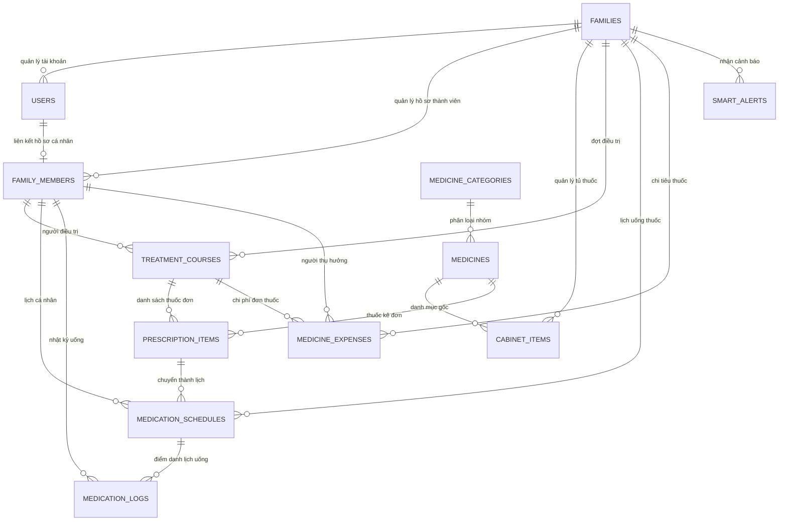

# TÀI LIỆU MÔ TẢ TỔNG QUAN DỰ ÁN & KẾ HOẠCH THỰC HIỆN ĐATN

---

## 🏛️ THÔNG TIN HÀNH CHÍNH ĐỒ ÁN TỐT NGHIỆP
- **Cơ quan chủ quản**: Bộ Giáo dục và Đào tạo – Trường Đại học Xây dựng Hà Nội (HUCE)
- **Khoa**: Công nghệ Thông tin
- **Bộ môn / Nhóm chuyên môn**: Kỹ thuật hệ thống và mạng máy tính
- **Họ và tên sinh viên**: **Lê Quang Khải**
- **Mã số sinh viên**: **0097567**
- **Lớp**: **67CNMHT** | **Khóa**: **67**
- **Ngành / Chuyên ngành**: Mạng và Hệ thống thông tin (Cử nhân)
- **Giảng viên hướng dẫn**: **ThS. Bùi Thanh Phong** (Email/ĐT: 0964719878)
- **Email liên hệ sinh viên**: Khaicon2503@gmail.com
- **Địa điểm thực hiện**: Trường Đại học Xây dựng Hà Nội
- **Thời gian thực hiện**: 15 tuần (Từ 07/09/2026 đến 13/12/2026) – Đợt 1
- **Tên đề tài chính thức**: **XÂY DỰNG NỀN TẢNG WEB QUẢN LÝ TỦ THUỐC CÁ NHÂN VÀ ĐIỀU TRỊ NGOẠI TRÚ CHO HỘ GIA ĐÌNH**

---

## 🎯 1. BỐI CẢNH, MỤC TIÊU & YÊU CẦU CỦA ĐỒ ÁN

### 1.1. Thực trạng & Bài toán Thực tế
Tại các hộ gia đình Việt Nam hiện nay, việc quản lý thuốc chữa bệnh và thực phẩm chức năng còn rất nhiều bất cập:
- **Nguy cơ ngộ độc thuốc quá hạn**: Vỉ thuốc bóc dở, thuốc cắt vụn làm mất hạn sử dụng (EXP/HSD). Thuốc hết hạn để lẫn thuốc mới gây nguy hiểm tính mạng.
- **Quên & Nhầm lẫn liều dùng**: Người cao tuổi, trẻ nhỏ hoặc người mắc bệnh mạn tính (tiểu đường, tăng huyết áp) thường xuyên quên cữ uống (sáng/trưa/chiều/tối, trước/sau ăn) hoặc uống quá liều.
- **Lãng phí & Mua trùng lặp**: Khi ốm sốt, người nhà ra tiệm mua thuốc mới trong khi tủ thuốc gia đình vẫn còn nhưng không nhớ hoặc không tìm thấy.
- **Khó khăn theo dõi từ xa**: Con cái đi làm xa không thể trực tiếp kiểm tra xem bố mẹ ở nhà đã uống thuốc đúng giờ chưa.
- **Chi phí không kiểm soát**: Thiếu công cụ ghi nhận và thống kê chi phí mua sắm thuốc men theo từng đợt bệnh của các thành viên.

### 1.2. Mục tiêu của Đồ án
Nghiên cứu, thiết kế và phát triển nền tảng Web thông minh giúp các hộ gia đình:
1. Số hóa toàn diện tủ thuốc trong nhà, theo dõi hạn sử dụng và số lượng tồn kho theo thời gian thực.
2. Lập lịch uống thuốc chi tiết theo đơn điều trị ngoại trú của từng thành viên, tự động nhắc nhở và ghi nhận nhật ký tuân thủ dùng thuốc.
3. Cảnh báo tự động về thuốc cận hạn, thuốc hết hạn, tồn kho sắp cạn và cảnh báo an toàn dùng thuốc.
4. Thống kê chi phí mua sắm thuốc men minh bạch, trực quan theo tháng/quý (VNĐ).

### 1.3. Yêu cầu Hệ thống
- **Giao diện trực quan, thân thiện**: Phù hợp cho mọi lứa tuổi trong gia đình, hỗ trợ Responsive chuẩn trên máy tính, tablet và smartphone.
- **Tự động hóa cao**: Cơ chế tự động quét trạng thái hạn dùng và gửi thông báo cảnh báo thông minh không cần người dùng can thiệp thủ công.
- **Bảo mật & Phân quyền**: Phân chia vai trò rõ ràng giữa Chủ hộ (Family Admin) và Thành viên (Member), đảm bảo tính toàn vẹn dữ liệu y tế gia đình.

---

## 🛠️ 2. KIẾN TRÚC CÔNG NGHỆ & QUY CHUẨN KỸ THUẬT

| Thành phần | Công nghệ / Thư viện lựa chọn | Vai trò trong hệ thống |
| :--- | :--- | :--- |
| **Backend Framework** | **Laravel 12.x (PHP 8.2+)** | Kiến trúc chuẩn MVC, routing, authentication, Eloquent ORM, task scheduling |
| **Cơ sở dữ liệu** | **MySQL 8.0+ / SQLite** | Hệ quản trị CSDL quan hệ chuẩn hóa 3NF, toàn vẹn khóa ngoại |
| **Frontend UI** | **Laravel Blade + Bootstrap 5 + Vanilla CSS/JS** | Giao diện hiện đại, responsive, tải trang nhanh |
| **Lịch trình tương tác** | **FullCalendar.js** | Hiển thị lịch uống thuốc trực quan theo ngày/tuần/tháng cho từng thành viên |
| **Báo cáo biểu đồ** | **Chart.js** | Trực quan hóa chi tiêu tiền thuốc và tỷ lệ tuân thủ uống thuốc |
| **Bảng dữ liệu** | **DataTables.net** | Tìm kiếm, lọc, phân trang danh mục thuốc chuẩn và tồn kho tủ thuốc |
| **Trợ lý Y tế & An toàn** | **Gemini AI Service / Local Rule Engine** | Hỗ trợ đọc đơn thuốc (OCR), kiểm tra trùng hoạt chất Paracetamol, chống chỉ định dị ứng |
| **Môi trường triển khai** | **XAMPP / Laragon / Visual Studio Code** | Môi trường phát triển và kiểm thử chuẩn mực |

---

## 🗄️ 3. THIẾT KẾ CƠ SỞ DỮ LIỆU (12 BẢNG CHUẨN 3NF)



### Chi tiết các phân hệ dữ liệu:
1. **`families`**: Quản lý thông tin hộ gia đình, mã mời tham gia độc nhất (`code`).
2. **`users`**: Tài khoản đăng nhập, liên kết `family_id`, phân quyền (`family_admin`, `member`, `doctor_caregiver`).
3. **`family_members`**: Hồ sơ sức khỏe của từng người thân (Ông bà, Bố mẹ, Con nhỏ), nhóm máu, bệnh nền, tiền sử dị ứng thuốc.
4. **`medicine_categories`**: 8 nhóm thuốc chuẩn (Kháng sinh, Giảm đau hạ sốt, Tim mạch huyết áp, Tiêu hóa, Hô hấp, Dị ứng, Vitamin, Sơ cứu).
5. **`medicines`**: Master Data dược phẩm (mã lưu hành, tên thương mại, hoạt chất, hàm lượng, dạng bào chế, đơn vị, nhà sản xuất, chỉ định, chống chỉ định).
6. **`cabinet_items`**: Tủ thuốc thực tế của gia đình (vị trí ngăn tủ, số lô, NSX, HSD, số lượng tồn, đơn giá, trạng thái).
7. **`treatment_courses`**: Đơn thuốc / đợt điều trị ngoại trú của thành viên, bác sĩ/bệnh viện, chẩn đoán, ảnh đơn thuốc, dữ liệu phân tích.
8. **`prescription_items`**: Chi tiết thuốc trong đơn điều trị (liều lượng, tần suất, cách dùng).
9. **`medication_schedules`**: Lịch uống thuốc chi tiết theo cữ (Sáng, Trưa, Chiều, Tối), giờ uống, quy định trước/sau ăn.
10. **`medication_logs`**: Nhật ký uống thuốc thực tế (`da_uong`, `quen_uong`, `bo_qua`), thời gian uống thực tế và ghi chú.
11. **`medicine_expenses`**: Nhật ký chi phí mua thuốc và khám bệnh (VNĐ), lưu ảnh hóa đơn.
12. **`smart_alerts`**: Hệ thống cảnh báo tự động (thuốc quá hạn, cận hạn 30 ngày, cạn tồn kho, nhắc lịch, tương tác an toàn).

---

## 📅 4. KẾ HOẠCH TIẾN ĐỘ 14 TUẦN & NHẬT KÝ THỰC HIỆN ĐATN (MẪU ĐATN-02)

| Tuần | Thời gian | Nhiệm vụ chính | Kết quả & Sản phẩm đạt được |
| :---: | :---: | :--- | :--- |
| **Tuần 1** | 07/09 – 13/09/2026 | Khảo sát bài toán thực tế, xác định yêu cầu chức năng & phi chức năng | Hoàn thành tài liệu phân tích nghiệp vụ, danh sách tác nhân (User, Admin) |
| **Tuần 2** | 14/09 – 20/09/2026 | Thiết kế CSDL (3NF), vẽ ERD, thiết kế luồng xử lý thông báo | Hoàn thành sơ đồ ERD 12 thực thể, thiết kế ràng buộc khóa ngoại |
| **Tuần 3** | 21/09 – 27/09/2026 | Hoàn thiện tài liệu thiết kế hệ thống Mốc ĐATN-01 | Chốt phương án thiết kế CSDL với GVHD (ThS. Bùi Thanh Phong) - **Đánh giá M1** |
| **Tuần 4** | 28/09 – 04/10/2026 | Khởi tạo dự án Laravel, Migrations & Seeders Master Data thuốc VN | Khởi tạo thành công Laravel project, 12 migrations & 8 seeders dữ liệu thực tế |
| **Tuần 5** | 05/10 – 11/10/2026 | Phát triển phân hệ Quản lý Tủ thuốc (CRUD, tồn kho, HSD) | Xây dựng Controller, Model, View Blade quản lý tồn kho và hạn dùng |
| **Tuần 6** | 12/10 – 18/10/2026 | Phân hệ Quản lý Thành viên gia đình & Tra cứu danh mục thuốc | Phân quyền Chủ hộ/Thành viên, trang tra cứu thông tin thuốc nhanh |
| **Tuần 7** | 19/10 – 25/10/2026 | Báo cáo tiến độ giữa kỳ, nhận góp ý từ Hội đồng (**Đánh giá M2**) | Báo cáo slide và demo tiến độ nửa đầu kỳ thành công trước Hội đồng |
| **Tuần 8** | 26/10 – 01/11/2026 | Lập lịch điều trị ngoại trú & Lịch uống thuốc (Tích hợp FullCalendar) | Hoàn thành giao diện xem lịch trực quan theo ngày/tuần cho các thành viên |
| **Tuần 9** | 02/11 – 08/11/2026 | Xây dựng cơ chế tự động quét & cảnh báo thông minh (Scheduling) | Hoàn thành Artisan command `cabinet:scan-alerts`, tự động bắt thuốc cận date |
| **Tuần 10** | 09/11 – 15/11/2026 | Phân hệ Báo cáo & Thống kê chi phí (Tích hợp Chart.js) | Dashboard thống kê chi phí mua thuốc theo tháng/quý (VNĐ) và tỷ lệ uống đúng giờ |
| **Tuần 11** | 16/11 – 22/11/2026 | Kiểm thử toàn diện (Testing), rà soát bảo mật CSRF/XSS, tối ưu UI/UX | 100% unit/feature tests passed, giao diện Responsive mượt mà |
| **Tuần 12** | 23/11 – 29/11/2026 | Hoàn thiện quyển báo cáo ĐATN, đóng gói mã nguồn (**Nộp ĐATN & M3**) | Nộp quyển thuyết minh đồ án và mã nguồn hoàn chỉnh đúng hạn 25/11/2026 |
| **Tuần 13** | 30/11 – 06/12/2026 | Chuẩn bị Slide thuyết trình, luyện tập kịch bản demo và phản biện | Slide chuyên nghiệp, video demo các tình huống sử dụng thực tế |
| **Tuần 14** | 07/12 – 13/12/2026 | Hoàn tất thủ tục hành chính tại Khoa CNTT, sẵn sàng bảo vệ | Sẵn sàng bảo vệ chính thức trước Hội đồng ĐATN (Tuần 15) |

---

## 🗺️ 5. BẢN ĐỒ PHÂN HỆ CHỨC NĂNG (FEATURE SITEMAP)

```
[HỆ THỐNG QUẢN LÝ TỦ THUỐC GIA ĐÌNH]
│
├── 🔐 1. PHÂN HỆ XÁC THỰC & PHÂN QUYỀN (Auth & Family Roles)
│   ├── Đăng ký / Đăng nhập / Quên mật khẩu
│   ├── Tạo hộ gia đình mới (sinh mã mời Code duy nhất)
│   ├── Tham gia vào gia đình qua mã mời
│   └── Phân quyền: Chủ hộ (Admin) toàn quyền quản lý, Thành viên (Member) theo dõi
│
├── 💊 2. PHÂN HỆ QUẢN LÝ TỦ THUỐC (Medicine Cabinet Management)
│   ├── Danh mục thuốc trong tủ (Tên thuốc, vị trí ngăn tủ, số lượng, đơn vị, giá)
│   ├── Quản lý hạn sử dụng (Ngày sản xuất, Ngày hết hạn, Số lô)
│   ├── Lọc nhanh: Thuốc còn hạn, Thuốc cận date (<30 ngày), Thuốc quá hạn, Thuốc sắp hết
│   └── Thêm thuốc mới (chọn từ Master Data có sẵn hoặc tự nhập thuốc riêng)
│
├── 👨‍👩‍👧‍👦 3. PHÂN HỆ HỒ SƠ SỨC KHỎE THÀNH VIÊN (Family Health Profiles)
│   ├── Danh sách thành viên (Ông bà, Bố mẹ, Con cái)
│   ├── Thông tin y tế: Năm sinh, Giới tính, Nhóm máu
│   ├── Tiền sử dị ứng thuốc (Aspirin, Penicillin, NSAID...)
│   └── Bệnh lý nền (Cao huyết áp, Tiểu đường, Tim mạch, Dạ dày...)
│
├── 📋 4. PHÂN HỆ ĐIỀU TRỊ NGOẠI TRÚ & ĐƠN THUỐC (Treatment Courses)
│   ├── Khai báo đợt bệnh / đơn thuốc (Chẩn đoán, Bác sĩ/Bệnh viện, Ngày bắt đầu/kết thúc)
│   ├── Danh sách thuốc trong đơn (Liều lượng, Cách dùng, Tần suất)
│   ├── Lưu trữ ảnh chụp đơn thuốc gốc của bệnh viện
│   └── Tự động sinh lịch uống thuốc từ đơn điều trị
│
├── ⏰ 5. PHÂN HỆ LẬP LỊCH & ĐIỂM DANH UỐNG THUỐC (Medication Schedules & Logs)
│   ├── Lịch uống thuốc hàng ngày chia theo cữ: Sáng, Trưa, Chiều, Tối
│   ├── Thời điểm dùng thuốc: Trước ăn, Sau ăn, Trong bữa ăn
│   ├── Chế độ xem Lịch tương tác (FullCalendar): Theo ngày, tuần, tháng
│   └── Điểm danh uống thuốc: Đánh dấu [Đã uống], [Quên uống], [Bỏ qua]
│
├── 🔔 6. PHÂN HỆ CẢNH BÁO TỰ ĐỘNG THÔNG MINH (Smart Alerts)
│   ├── Cảnh báo ĐỎ (Nguy hiểm): Thuốc đã quá hạn sử dụng, cảnh báo tương tác thuốc
│   ├── Cảnh báo VÀNG (Lưu ý): Thuốc cận date (dưới 30 ngày), vật tư sắp hết trong tủ
│   ├── Cảnh báo XANH (Nhắc nhở): Nhắc cữ uống thuốc hàng ngày của người thân
│   └── Command tự động quét nền: php artisan cabinet:scan-alerts
│
├── 🔍 7. PHÂN HỆ TRA CỨU DANH MỤC THUỐC CHUẨN (Medicine Master Data)
│   ├── Tra cứu hơn 25+ loại thuốc thông dụng tại Việt Nam (DataTables tìm kiếm tức thì)
│   ├── Xem chi tiết hoạt chất, hàm lượng, công dụng, tác dụng phụ và chống chỉ định
│   └── Gợi ý phân loại theo nhóm dược lý
│
├── 📊 8. PHÂN HỆ BÁO CÁO & THỐNG KÊ CHI PHÍ (Analytics & Expenses)
│   ├── Quản lý chi tiêu mua sắm thuốc và tiền khám bệnh (VNĐ)
│   ├── Biểu đồ chi phí thuốc theo tháng/quý (Chart.js)
│   ├── Thống kê tỷ lệ tuân thủ lịch uống thuốc của từng thành viên
│   └── Xuất danh sách thuốc cần mua bổ sung
│
└── 🤖 9. TRỢ LÝ Y TẾ AI (Gemini AI Service / Local Rule-Engine)
    ├── Vision OCR: Đọc ảnh đơn thuốc & trích xuất thông tin tự động
    ├── Drug Safety Checker: Tự động cảnh báo quá liều Paracetamol & dị ứng thuốc
    └── Plain-Language Explainer: Giải thích đơn thuốc bằng ngôn ngữ bình dân, dễ hiểu
```

---

## 🚀 6. HƯỚNG DẪN CÀI ĐẶT & CHẠY DỰ ÁN

### Yêu cầu hệ thống:
- PHP >= 8.2 (đã kích hoạt extension `pdo_mysql`, `pdo_sqlite`, `curl`, `fileinfo`)
- Composer >= 2.x
- Node.js & NPM
- MySQL Server (hoặc sử dụng sẵn SQLite mặc định)

### Các bước khởi chạy:
```bash
# 1. Cài đặt các gói phụ thuộc PHP (nếu tải mới)
composer install

# 2. Cấu hình tệp môi trường
cp .env.example .env
php artisan key:generate

# 3. Tạo cơ sở dữ liệu và nạp toàn bộ dữ liệu mẫu thực tế Việt Nam
php artisan migrate:fresh --seed

# 4. Liên kết thư mục lưu trữ ảnh đơn thuốc và hóa đơn
php artisan storage:link

# 5. Chạy bộ kiểm thử tự động xác minh toàn bộ hệ thống
php artisan test

# 6. Khởi động Web Server
php artisan serve
```

*Tài liệu này là căn cứ xuyên suốt cho quá trình phát triển dự án, viết quyển thuyết minh Đồ án tốt nghiệp và báo cáo định kỳ với Giảng viên hướng dẫn.*
